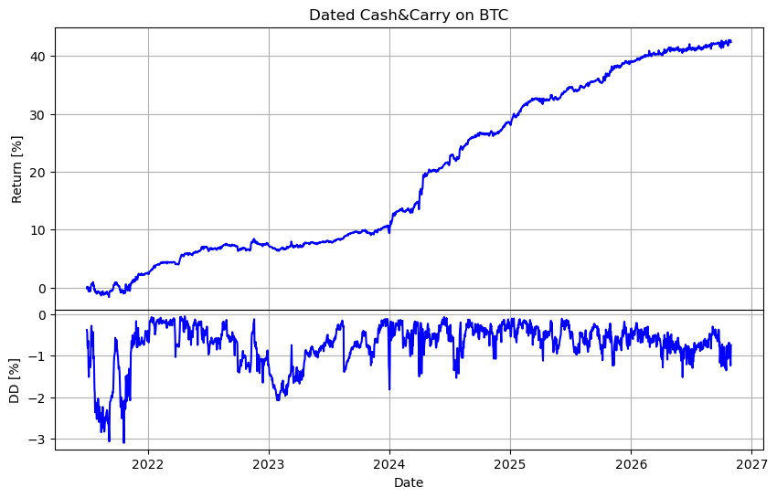
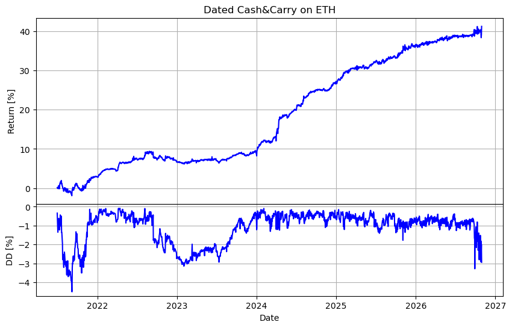
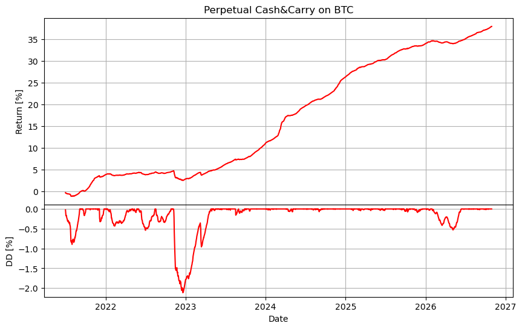
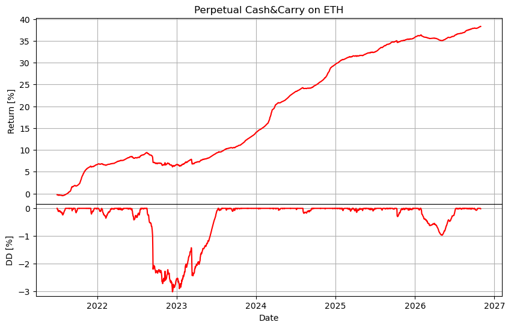
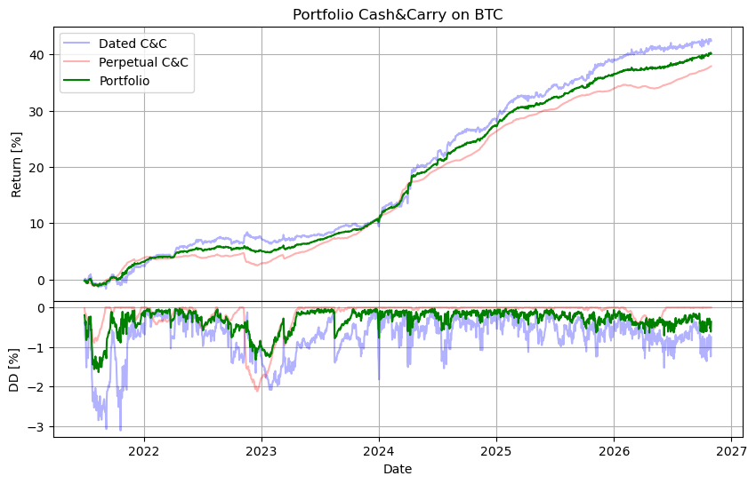
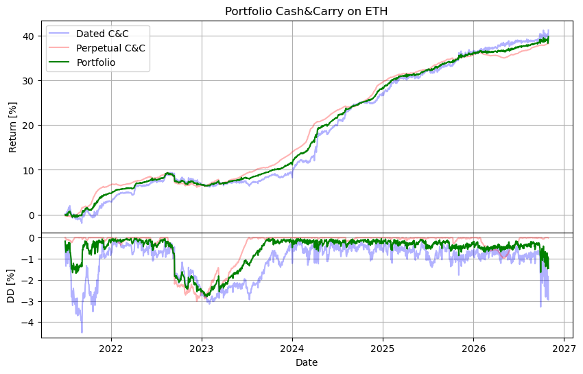
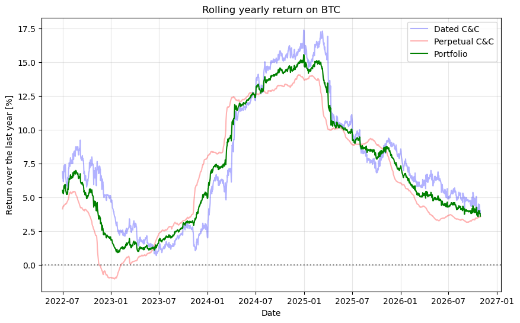
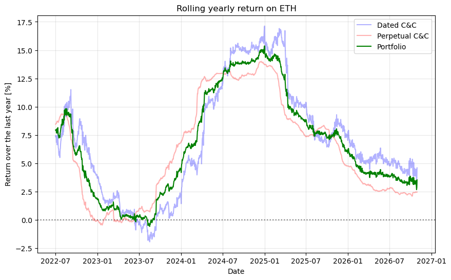

# Introduction
This repository contains a study of the cash&carry (C&C) strategy on the inverse futures of Bybit, for BTC and ETH. The strategy consists in buying the cryptocurrency on the spot market and, at the same time, opening a short position of equal notional on an inverse futures, using the purchased cryptocurrency as collateral: the position is (approximately) neutral with respect to the price, and the profit comes from the premium of the futures over the spot.

Two variants are backtested:

- **dated C&C**: the short is opened on the quarterly futures; among the contracts with at least 30 days left to expiry, the one with the maximum annualized premium is chosen, and the position is held until expiry, when a new contract is opened;
- **perpetual C&C**: the short is opened on the inverse perpetual futures, and the profit comes from the *funding*; the funding obtained is reinvested, by increasing the short position as soon as it is large enough.

The notebook also combines the two variants in an equally weighted portfolio. In this document, we describe the mathematics of the two variants, and we show the results of each of them and of the portfolio.

# Repository structure
```
cash_and_carry/
├── data/                  # Bybit data (parquet), downloaded by the notebook and cached
├── figures/               # figures produced by the notebook
├── notebooks/
│   └── backtest.ipynb     # data download and backtest of the strategy
├── .gitignore
└── README.md
```

The data are downloaded from the public API of Bybit (no API key is needed) only if the corresponding file is not present in `data/`; to update them, the files must be deleted.

# Theory

## Dated futures C&C
In this section, we describe the mathematics behind a cash&carry operation done on the inverse dated futures, i.e., the futures with a fixed expiry (on Bybit, the quarterly futures expire on the last Friday of March, June, September and December, at 08:00 UTC).

At the initial time $`t_0`$, let us imagine having a capital $`C_\$`$ in USD; the quantity of cryptocurrency we can buy is:

```math
C_\text{฿} = \frac{C_\$}{p_0}\, (1 - \phi_s)\,,
```

where $`p_0`$ is the quote of the cryptocurrency in USD and $`\phi_s`$ is the fee rate for the spot.

Denoting by $`q_j(t)`$ the quote of the futures with expiry $`T_j`$, the annualized premium of the futures over the spot is:

```math
R_j(t) = \left(\frac{q_j(t)}{p(t)} - 1\right)\, \frac{365}{T_j - t}\,,
```

with $`T_j - t`$ expressed in days. At the expiry, the futures quotes as the spot, i.e., $`q_j(T_j) = p(T_j)`$, so the premium goes to zero. At the opening time $`t_o`$, among the futures with at least $`D`$ days left to expiry, we choose the one with the maximum annualized premium:

```math
j^* = \underset{j\,:\; T_j - t_o \geq D}{\arg\max}\, R_j(t_o)\,.
```

Denoting by $`q_o = q_{j^*}(t_o)`$ its quote, by $`W(t_o)`$ the balance of the portfolio in cryptocurrency at the opening (with $`W(t_0) = C_\text{฿}`$), by $`k`$ the multiplier of the inverse futures[^1] and by $`\ell`$ the leverage used, the number of futures contracts on which we go short is:

```math
n_c = \left\lfloor\frac{\ell\, W(t_o)\, q_o}{k}\right\rfloor\,,
```

and the opening involves the payment of a fee $`k\, n_c\, \phi_f/q_o`$, where $`\phi_f`$ is the fee rate for the futures, which is subtracted from the balance. At a given instant $`t`$, the short position on the futures involves a P&L (expressed in cryptocurrency) given by:

```math
PL_f(t) = k\, n_c\, \left(\frac{1}{q_{j^*}(t)} - \frac{1}{q_o}\right)\,.
```

The position is held until the expiry $`T_{j^*}`$, when it is closed at the price $`q_{j^*}(T_{j^*}) = p(T_{j^*})`$, paying a delivery fee with rate $`\phi_d`$; the balance of the portfolio becomes:

```math
W(T_{j^*}) = W(t_o) - \frac{k\, n_c\, \phi_f}{q_o} + k\, n_c\, \left(\frac{1}{p(T_{j^*})} - \frac{1}{q_o}\right) - \frac{k\, n_c\, \phi_d}{p(T_{j^*})}\,,
```

and, at the same instant, a new futures is opened, following the same rule. Since $`n_c`$ is computed each time starting from the current balance, the profit of each contract is automatically reinvested at the following opening.

The equity in USD and the net equity are, respectively:

```math
\tilde E_\$(t) = \left[W(t) + PL_f(t)\right]\, p(t)\,, \qquad E_\$(t) = (1 - \phi_s)\, \left[\tilde E_\$(t) - k\, n_c\, \phi_f\right]\,.
```

To understand where the profit comes from, let us consider $`\ell = 1`$ and let us neglect the rounding and the fees, so that $`k\, n_c \simeq W(t_o)\, q_o`$; in this case, during the life of the contract we have:

```math
\tilde E_\$(t) \simeq \left[W(t_o) + W(t_o)\, q_o\, \left(\frac{1}{q_{j^*}(t)} - \frac{1}{q_o}\right)\right]\, p(t) = W(t_o)\, q_o\, \frac{p(t)}{q_{j^*}(t)}\,.
```

At the expiry, $`q_{j^*} = p`$, so $`\tilde E_\$(T_{j^*}) \simeq W(t_o)\, q_o`$: compared with the value $`W(t_o)\, p(t_o)`$ at the opening, the return is $`q_o/p(t_o) - 1`$, i.e., the premium at the opening, regardless of the price movements. Before the expiry, instead, the equity depends on the ratio $`p/q_{j^*}`$, i.e., on the current premium: if the premium increases (which typically happens in the bullish phases), the equity decreases, and it recovers as the premium converges to zero at the expiry. Therefore, the drawdowns of the dated C&C are mainly due to the mark-to-market of the premium, and they are not realized if the position is held until the expiry.

## Perpetual futures C&C
This section refers to the C&C done on the inverse perpetual futures, first without and then with reinvestment of the funding.

### Cash&carry on perpetual without reinvestment
In this section, we describe the mathematics behind a cash&carry operation done on the inverse perpetual futures, without reinvestment of the obtained *funding*.

At the initial time $`t_0`$, let us imagine having a capital $`C_\$`$ in USD; the quantity of cryptocurrency we can buy is:

```math
C_\text{฿} = \frac{C_\$}{p_0}\, (1 - \phi_s)\,,
```

where $`p_0`$ is the quote of the cryptocurrency in USD and $`\phi_s`$ is the fee rate for the spot.

The cash&carry strategy on perpetual futures consists in opening a short position using the purchased cryptocurrency as collateral, and collecting the *funding* which is periodically paid (in normal conditions, it is the short counterparty that collects it).

Denoting by $`k`$ the multiplier of the inverse futures, by $`\ell`$ the leverage used and by $`p_f`$ the quote of the cryptocurrency at the time $`t_f`$ of opening of the position, the number of futures contracts on which we go short is:

```math
n_c = \left\lfloor\frac{\ell\, C_\text{฿}\, p_f}{k}\right\rfloor\,.
```

The opening of a position on the futures also involves the payment of a fee, given by:

```math
\mathrm{fee}_f = \frac{k\, n_c\, \phi_f}{p_f}\,,
```

where $`\phi_f`$ is the fee rate for the futures; therefore, the net value $`W_0`$ of the portfolio is:

```math
W_0 = C_\text{฿} - \mathrm{fee}_f\,.
```

Since the number $`n_c`$ of contracts is computed starting from $`C_\text{฿}`$, while the net value of the portfolio is $`W_0 < C_\text{฿}`$, the cash&carry is in fact slightly short with respect to the cryptocurrency, even with $`\ell = 1`$ (at the same time, there would also be a slight long effect deriving from the fact that $`n_c`$ is rounded down, thus leaving part of the cryptocurrency position partially unhedged; however, this effect is often negligible).

An open position on an inverse perpetual futures involves the payment of a *funding* which depends on the *funding rate* $`r(t)`$ and on the notional of the position, and is defined as:

```math
f(t) = \frac{k\, n_c\, r(t)}{p(t)}\,,
```

and is expressed in cryptocurrency. From this it follows that the USD value of the funding received at time $`t`$, at that given instant, is $`f_\$ = k\, n_c\, r(t)`$, i.e., it depends on time only through the funding rate. Overall, the balance of the portfolio, over time, is:

```math
W(t) = W_0 + \sum_{t_f < t'\leq t}f(t')\,.
```

Moreover, at a given instant $`t`$, the short position on the futures involves a P&L (expressed in cryptocurrency) given by:

```math
PL_f(t) = k\, n_c\, \left(\frac{1}{p(t)} - \frac{1}{p_f}\right)\,.
```

Overall, therefore, the equity in cryptocurrency as a function of time is:

```math
\tilde E_\text{฿}(t) = W(t) + PL_f(t) = W_0 + \sum_{t_f < t'\leq t}f(t') + k\, n_c\, \left(\frac{1}{p(t)} - \frac{1}{p_f}\right)\,.
```

To obtain the corresponding value in USD, it is sufficient to multiply the total quantity of cryptocurrency by the current quote, obtaining:

```math
\tilde E_\$(t) = \tilde E_\text{฿}(t)\,p(t) = W_0\, p(t) + k\, n_c\, p(t)\, \left[\sum_{t_f < t'\leq t}\frac{r(t')}{p(t')} + \frac{1}{p(t)} - \frac{1}{p_f}\right]\,.
```

To obtain the net equity, we must consider that, when closing the position, a double fee has to be paid: for the closing of the short on the futures, and for the sale of the resulting spot. The net equity is therefore:

```math
E_\$(t) = (1 - \phi_s)\, \left[\tilde E_\$(t) - k\, n_c\, \phi_f\right]\,.
```

It is important to note that, in this formulation, the quantity of cryptocurrency obtained from the funding is exposed to the price risk, since it is not hedged by the futures; in the following section, we see how things change with reinvestment.

### Cash&carry on perpetual with reinvestment
In case we want to keep hedging the cryptocurrency position, it is necessary to open further positions on the futures; this can be done at the moment when we come to hold a quantity of cryptocurrency sufficient to open a contract, i.e., when:

```math
\Delta n_c(t) \equiv \left\lfloor\frac{\ell\, p(t)\, F(t)}{k}\right\rfloor \geq 1\,,
```

where $`F(t)`$ is the quantity of cryptocurrency deriving from the funding not yet hedged by the futures:

```math
F(t) = \sum_{t_f < t'\leq t} f(t') - \sum_{t'\in T_c^{(t)}}\frac{k\, \Delta n_c(t')}{\ell\, p(t')}\,,
```

with $`T_c^{(t)}`$ the set of the rehedge instants preceding $`t`$. The second term represents the cryptocurrency hedged by the rehedges already done: since $`\Delta n_c`$ is rounded down, at each rehedge an unhedged residual of funding remains, which is carried forward and contributes to the following rehedge. When the condition on $`\Delta n_c(t)`$ is satisfied, it is possible to increase the short position on the futures by $`\Delta n_c(t)`$[^2].

The new average entry price of the position can be computed taking into account that the P&L of the futures (in cryptocurrency, since this is the reference currency for the futures) at any instant $`\bar t`$ must coincide with the sum of the P&Ls deriving from the single positions; defining $`p_c`$ the rehedge price and $`p_m`$ the average entry price, we obtain:

```math
k\, (n_c + \Delta n_c)\,\left(\frac{1}{\bar p} - \frac{1}{p_m}\right) = k\, n_c\,\left(\frac{1}{\bar p} - \frac{1}{p_f}\right) + k\, \Delta n_c\,\left(\frac{1}{\bar p} - \frac{1}{p_c}\right)\,,
```

from which:

```math
p_m = \frac{n_c + \Delta n_c}{\dfrac{n_c}{p_f} + \dfrac{\Delta n_c}{p_c}}\,.
```

Therefore, the average entry price is the (weighted) harmonic mean between the rehedge price and $`p_f`$. For subsequent rehedges, the starting configuration will no longer be $`(n_c,\, p_f)`$ but $`(n_c(t),\, p_m)`$.

Apart from these modifications, the computations of the previous section remain valid, with a couple of clarifications:

- the funding must be computed starting from the number of futures contracts, which varies over time:

```math
f(t) = \frac{k\, n_c(t)\, r(t)}{p(t)}\,;
```

- the rehedge leads to a decrease of the balance of the portfolio:

```math
W(t) = W_0 + \sum_{t_f < t'\leq t}f(t') - k\, \phi_f\,\sum_{t'\in T_c^{(t)}}\frac{\Delta n_c(t')}{p(t')}\,;
```

- the P&L deriving from the futures is:

```math
PL_f(t) = k\, n_c(t)\,\left(\frac{1}{p(t)} - \frac{1}{p_m(t)}\right)\,;
```

- the equity in USD $`\tilde E_\$(t)`$ becomes:

```math
\begin{aligned}
\tilde E_\$(t) &= \left[W(t) + PL_f(t)\right]\, p(t)\\[.2cm]
&= \left[W_0 - k\, \phi_f\,\sum_{t'\in T_c^{(t)}}\frac{\Delta n_c(t')}{p(t')}\right]\, p(t) + p(t)\,\sum_{t_f < t'\leq t}f(t') \\[.2cm]
&\quad + k\, n_c(t)\, p(t)\, \left[\frac{1}{p(t)} - \frac{1}{p_m(t)}\right]\,;
\end{aligned}
```

- finally, the net equity is obtained as:

```math
E_\$(t) = (1 - \phi_s)\, \left[\tilde E_\$(t) - k\, n_c(t)\, \phi_f\right]\,.
```

# Results of the dated cash&carry

## Data and setup
The backtest uses the following data, downloaded from Bybit:

- the hourly index price of `BTCUSD` and `ETHUSD`, used as spot price $`p(t)`$;
- the hourly quotes $`q_j(t)`$ of the inverse quarterly futures (e.g., `BTCUSDH21`, where the letters `H`, `M`, `U` and `Z` indicate the expiry in March, June, September and December), downloaded starting from about 200 days before each expiry; the missing quotes are forward-filled for at most 24 hours.

The operation starts on 2021-07-01 and ends on 2026-10-30 (last available data), i.e., it covers about 5.3 years. The parameters of the backtest are:

| Parameter | Value |
|---|---|
| Initial capital ($`C_\$`$) | 1000 USD |
| Multiplier of the inverse futures ($`k`$) | 1 USD |
| Leverage ($`\ell`$) | 1 |
| Fee rate for the spot ($`\phi_s`$) | 0.1% |
| Fee rate for the futures ($`\phi_f`$) | 0.055% |
| Fee rate for the delivery ($`\phi_d`$) | 0.05% |
| Minimum number of days left to expiry ($`D`$) | 30 |

Each position is held until the expiry, and the new contract is opened at the same instant. The equity shown below is always the net equity $`E_\$(t)`$, i.e., the value which would be obtained by closing the whole position at time $`t`$. The performance is measured by:

- the compound annual growth rate (CAGR);
- the drawdown (DD), computed on the equity at the frequency of the backtest (1 hour for the dated C&C, 8 hours for the perpetual one) and then taking the daily minimum; the average DD is the mean over the days in which the DD is non-zero;
- the annualized volatility of the daily returns of the equity;
- the correlation between the daily returns of the equity and those of the spot.

## Equity and drawdown
The equity and the drawdown of the dated C&C are shown in Figure 1 for BTC and in Figure 2 for ETH, while the main metrics are summarized in Table 1.



**Figure 1.** Net return (top) and drawdown (bottom) of the dated C&C on BTC.



**Figure 2.** Net return (top) and drawdown (bottom) of the dated C&C on ETH.

**Table 1.** Performance of the dated C&C.

| Metric | BTC | ETH |
|---|---|---|
| Total return | 42.40% | 41.28% |
| CAGR | 6.85% | 6.69% |
| Max DD | −3.11% | −4.50% |
| Average DD | −0.73% | −1.11% |
| CAGR / (average DD) | 9.39 | 6.03 |
| Annualized volatility | 3.35% | 4.10% |
| Correlation with the spot | −0.32 | −0.27 |
| Number of contracts | 14 | 13 |

The CAGR is about 6.5–7% per year for both cryptocurrencies. The maximum drawdown occurs in the bullish phase of 2021 (on 2021-10-21 for BTC and on 2021-09-07 for ETH), when the premium of the futures increased: as shown in the theory, before the expiry the equity decreases when the premium increases, and the loss is recovered as the premium converges to zero. For the same reason, the volatility (3–4% per year) is clearly higher than that of the perpetual C&C, and the correlation with the spot is negative: the premium tends to increase when the price goes up.

## Contracts
Tables 2 and 3 show the contracts opened during the backtest. The position is always open (a new contract is opened at each expiry), and the duration of each contract depends on which expiry has the maximum premium: about 3 months when the nearest contract is chosen, and about 6 months when the following one is chosen. The tables do not include the contracts opened on 2026-09-25 (`BTCUSDH27` and `ETHUSDH27`), which are still open at the end of the backtest.

**Table 2.** Contracts opened on BTC, with the annualized premium $`R_{j^*}(t_o)`$ at the opening and the return in USD of the position, from the opening to the expiry.

<table>
  <thead>
    <tr><th>Contract</th><th>Opening</th><th>Closing</th><th>Days</th><th>Annualized premium at opening</th><th>Return</th></tr>
  </thead>
  <tbody>
    <tr><td>BTCUSDZ21</td><td>2021-07-01</td><td>2021-12-31</td><td align="right">183</td><td align="right">5.85%</td><td align="right">2.88%</td></tr>
    <tr><td>BTCUSDH22</td><td>2021-12-31</td><td>2022-03-25</td><td align="right">84</td><td align="right">7.80%</td><td align="right">1.74%</td></tr>
    <tr><td>BTCUSDU22</td><td>2022-03-25</td><td>2022-09-30</td><td align="right">189</td><td align="right">5.39%</td><td align="right">2.74%</td></tr>
    <tr><td>BTCUSDH23</td><td>2022-09-30</td><td>2023-03-31</td><td align="right">182</td><td align="right">0.30%</td><td align="right">0.08%</td></tr>
    <tr><td>BTCUSDM23</td><td>2023-03-31</td><td>2023-06-30</td><td align="right">91</td><td align="right">3.57%</td><td align="right">0.84%</td></tr>
    <tr><td>BTCUSDU23</td><td>2023-06-30</td><td>2023-09-29</td><td align="right">91</td><td align="right">6.50%</td><td align="right">1.57%</td></tr>
    <tr><td>BTCUSDZ23</td><td>2023-09-29</td><td>2023-12-29</td><td align="right">91</td><td align="right">4.72%</td><td align="right">1.12%</td></tr>
    <tr><td>BTCUSDH24</td><td>2023-12-29</td><td>2024-03-29</td><td align="right">91</td><td align="right">15.49%</td><td align="right">3.78%</td></tr>
    <tr><td>BTCUSDM24</td><td>2024-03-29</td><td>2024-06-28</td><td align="right">91</td><td align="right">23.92%</td><td align="right">5.92%</td></tr>
    <tr><td>BTCUSDZ24</td><td>2024-06-28</td><td>2024-12-27</td><td align="right">182</td><td align="right">11.88%</td><td align="right">5.85%</td></tr>
    <tr><td>BTCUSDH25</td><td>2024-12-27</td><td>2025-03-28</td><td align="right">91</td><td align="right">12.72%</td><td align="right">3.13%</td></tr>
    <tr><td>BTCUSDU25</td><td>2025-03-28</td><td>2025-09-26</td><td align="right">182</td><td align="right">5.25%</td><td align="right">2.57%</td></tr>
    <tr><td>BTCUSDH26</td><td>2025-09-26</td><td>2026-03-27</td><td align="right">182</td><td align="right">6.83%</td><td align="right">3.36%</td></tr>
    <tr><td>BTCUSDU26</td><td>2026-03-27</td><td>2026-09-25</td><td align="right">182</td><td align="right">2.85%</td><td align="right">1.36%</td></tr>
  </tbody>
</table>

**Table 3.** Contracts opened on ETH, with the annualized premium $`R_{j^*}(t_o)`$ at the opening and the return in USD of the position, from the opening to the expiry.

<table>
  <thead>
    <tr><th>Contract</th><th>Opening</th><th>Closing</th><th>Days</th><th>Annualized premium at opening</th><th>Return</th></tr>
  </thead>
  <tbody>
    <tr><td>ETHUSDZ21</td><td>2021-07-01</td><td>2021-12-31</td><td align="right">183</td><td align="right">6.55%</td><td align="right">3.25%</td></tr>
    <tr><td>ETHUSDH22</td><td>2021-12-31</td><td>2022-03-25</td><td align="right">84</td><td align="right">8.24%</td><td align="right">1.85%</td></tr>
    <tr><td>ETHUSDU22</td><td>2022-03-25</td><td>2022-09-30</td><td align="right">189</td><td align="right">5.43%</td><td align="right">2.74%</td></tr>
    <tr><td>ETHUSDH23</td><td>2022-09-30</td><td>2023-03-31</td><td align="right">182</td><td align="right">−1.08%</td><td align="right">−0.58%</td></tr>
    <tr><td>ETHUSDM23</td><td>2023-03-31</td><td>2023-06-30</td><td align="right">91</td><td align="right">2.03%</td><td align="right">0.45%</td></tr>
    <tr><td>ETHUSDZ23</td><td>2023-06-30</td><td>2023-12-29</td><td align="right">182</td><td align="right">4.09%</td><td align="right">1.99%</td></tr>
    <tr><td>ETHUSDH24</td><td>2023-12-29</td><td>2024-03-29</td><td align="right">91</td><td align="right">14.68%</td><td align="right">3.62%</td></tr>
    <tr><td>ETHUSDM24</td><td>2024-03-29</td><td>2024-06-28</td><td align="right">91</td><td align="right">23.99%</td><td align="right">5.93%</td></tr>
    <tr><td>ETHUSDZ24</td><td>2024-06-28</td><td>2024-12-27</td><td align="right">182</td><td align="right">11.89%</td><td align="right">5.88%</td></tr>
    <tr><td>ETHUSDH25</td><td>2024-12-27</td><td>2025-03-28</td><td align="right">91</td><td align="right">11.95%</td><td align="right">2.94%</td></tr>
    <tr><td>ETHUSDU25</td><td>2025-03-28</td><td>2025-09-26</td><td align="right">182</td><td align="right">4.78%</td><td align="right">2.30%</td></tr>
    <tr><td>ETHUSDH26</td><td>2025-09-26</td><td>2026-03-27</td><td align="right">182</td><td align="right">5.96%</td><td align="right">2.94%</td></tr>
    <tr><td>ETHUSDU26</td><td>2026-03-27</td><td>2026-09-25</td><td align="right">182</td><td align="right">2.83%</td><td align="right">1.36%</td></tr>
  </tbody>
</table>

The mean annualized premium at the opening is 8.08% for BTC and 7.80% for ETH (the median is 6.17% and 5.96%, respectively). The return of each contract is very close to the premium at the opening rescaled on the duration of the contract, as expected from the theory: for instance, `BTCUSDZ21` was opened with an annualized premium of 5.85% and held for 183 days, which corresponds to $`5.85\% 	imes 183/365 \simeq 2.93\%`$, against a return of 2.88% (the difference is due to the fees). The highest premiums (up to about 24% per year) were found between the end of 2023 and the beginning of 2024, while the lowest ones in the second half of 2022, after the bearish phase: the contract `ETHUSDH23` was opened with a negative premium (−1.08%), since the strategy always chooses the maximum premium, even when it is negative, and it is the only contract which closed with a loss (−0.58%).

## Conclusions
On the period 2021-07 to 2026-10, the dated C&C obtained a CAGR of 6.85% on BTC and 6.69% on ETH. The return of each contract is fixed at the opening by the premium of the futures, so the profit does not depend on the price; however, the mark-to-market of the premium causes drawdowns of up to 3–4.5%, and a volatility higher than that of the perpetual C&C.

The backtest has some limitations:

- the quotes of the futures are the hourly close prices, so the bid-ask spread and the slippage are not modelled;
- the margin requirements are not modelled;
- a single set of parameters is tested (in particular, $`\ell = 1`$ and $`D = 30`$ days), and no minimum premium is required to open a contract.

# Results of the perpetual cash&carry

## Data and setup
Besides the spot price $`p(t)`$ described for the dated C&C, the backtest uses the history of the funding rate $`r(t)`$ of the inverse perpetuals `BTCUSD` and `ETHUSD`, which is paid every 8 hours. The spot is resampled on 8-hour bars, aligned with the funding times. The period is the same as for the dated C&C, and it covers 5841 funding payments for each cryptocurrency.

The parameters are the same as for the dated C&C, with the addition of the minimum rehedge value, which is equal to 1% of $`C_\$`$ (see footnote 2): a rehedge is done only when $`k\,\Delta n_c(t) \geq 10`$ USD. The equity shown below is the net equity $`E_\$(t)`$ of the perpetual C&C with reinvestment, and the performance is measured with the same metrics used for the dated C&C.

## Equity and drawdown
The equity and the drawdown of the perpetual C&C are shown in Figure 3 for BTC and in Figure 4 for ETH, while the main metrics are summarized in Table 4.



**Figure 3.** Net return (top) and drawdown (bottom) of the perpetual C&C on BTC.



**Figure 4.** Net return (top) and drawdown (bottom) of the perpetual C&C on ETH.

**Table 4.** Performance of the perpetual C&C, compared with the spot over the same period.

| Metric | BTC | ETH |
|---|---|---|
| Total return | 37.89% | 38.30% |
| CAGR | 6.21% | 6.27% |
| Max DD | −2.12% | −3.02% |
| Average DD | −0.29% | −0.57% |
| CAGR / (average DD) | 21.09 | 10.91 |
| Annualized volatility | 0.65% | 0.86% |
| Correlation with the spot | 0.07 | 0.03 |
| Number of rehedges | 38 | 38 |
| Total return of the spot | 122.0% | −1.2% |
| Max DD of the spot | −77.0% | −80.3% |

The two cryptocurrencies give very similar results, with a CAGR of about 6.2% per year, although the spot had a completely different behaviour in the two cases (+122% for BTC and −1% for ETH, with drawdowns of about −80% for both). The correlation with the spot is negligible, which confirms that the position is neutral with respect to the price: the equity grows almost monotonically, with a volatility below 1% per year.

## Dependence on the funding regime
Since the price risk is hedged, the return depends almost entirely on the funding rate. Table 5 shows, for each year, the return of the strategy and the mean funding rate, annualized ($`3 \times 365`$ payments per year).

**Table 5.** Yearly return of the perpetual C&C and annualized mean funding rate. 2021 starts on 2021-07-01, and 2026 ends on 2026-10-30.

<table>
  <thead>
    <tr><th rowspan="2">Year</th><th colspan="2">BTC</th><th colspan="2">ETH</th></tr>
    <tr><th>Return</th><th>Funding</th><th>Return</th><th>Funding</th></tr>
  </thead>
  <tbody>
    <tr><td>2021 (partial)</td><td align="right">4.15%</td><td align="right">8.52%</td><td align="right">6.94%</td><td align="right">13.41%</td></tr>
    <tr><td>2022</td><td align="right">−0.95%</td><td align="right">−0.35%</td><td align="right">−0.03%</td><td align="right">−0.12%</td></tr>
    <tr><td>2023</td><td align="right">7.92%</td><td align="right">7.87%</td><td align="right">6.84%</td><td align="right">7.40%</td></tr>
    <tr><td>2024</td><td align="right">13.80%</td><td align="right">12.72%</td><td align="right">13.81%</td><td align="right">12.76%</td></tr>
    <tr><td>2025</td><td align="right">6.05%</td><td align="right">5.90%</td><td align="right">4.76%</td><td align="right">4.98%</td></tr>
    <tr><td>2026 (partial)</td><td align="right">2.97%</td><td align="right">3.39%</td><td align="right">1.85%</td><td align="right">2.27%</td></tr>
  </tbody>
</table>

The yearly return follows closely the annualized funding rate. The median funding rate is 10.95% per year for both cryptocurrencies, which corresponds to 0.01% every 8 hours, i.e., the base value of the funding on Bybit; however, the funding is negative in about 20–21% of the payments, which lowers the mean to about 6.2–6.3% per year, in line with the CAGR.

The only losing year is 2022, when the funding was on average slightly negative. The maximum drawdown occurs at the end of 2022, during the market stress following the collapse of FTX: for BTC, the equity went down by 2.12% between 2022-11-07 and 2022-12-19, while the sum of the funding rates over the same period was about −1.97%, which corresponds to about −20 USD out of a drop of about 22 USD; for ETH, the drawdown of 3.02% (2022-08-19 to 2022-12-13) corresponds to a sum of the funding rates of about −3.17%. The drawdowns are therefore due to the periods of negative funding, and not to the price movements. As a consequence, the return over the last year (red curve in Figures 7 and 8, in the results of the portfolio) goes slightly below zero only at the beginning of 2023 (minimum of −1.06% for BTC and −0.45% for ETH), and reaches its maximum of about 14% at the end of 2024; at the end of the backtest, it is about 3.5% for BTC and 2.5% for ETH.

## Conclusions
On the period 2021-07 to 2026-10, the perpetual C&C with reinvestment of the funding obtained a CAGR of about 6.2% per year on both BTC and ETH, with a maximum drawdown of 2–3% and a negligible correlation with the spot. The return is essentially the funding rate, so it is not constant over time: it was close to zero in 2022, about 13–14% in 2024, and has decreased to about 2.5–3.5% in the last year.

The backtest has some limitations:

- the P&L of the futures is computed using the index price, so the basis between the perpetual and the index is neglected;
- the slippage and the margin requirements are not modelled;
- a single set of parameters is tested (in particular, $`\ell = 1`$ and a rehedge threshold of 1% of the capital).

# Results of the portfolio
The portfolio combines the two variants with equal weights: the initial capital is split into two halves, which are invested in the dated and in the perpetual C&C, respectively, without rebalancing. The equity of the portfolio is therefore the mean of the two equities, and its drawdown is computed on this mean.

## Equity and drawdown
The equity and the drawdown of the portfolio are shown in Figure 5 for BTC and in Figure 6 for ETH, together with those of the two variants, while Table 6 compares the main metrics.



**Figure 5.** Net return (top) and drawdown (bottom) of the portfolio on BTC (green), compared with the dated C&C (blue) and the perpetual C&C (red).



**Figure 6.** Net return (top) and drawdown (bottom) of the portfolio on ETH (green), compared with the dated C&C (blue) and the perpetual C&C (red).

**Table 6.** Performance of the dated C&C, of the perpetual C&C and of the portfolio.

<table>
  <thead>
    <tr><th rowspan="2">Metric</th><th colspan="3">BTC</th><th colspan="3">ETH</th></tr>
    <tr><th>Dated</th><th>Perpetual</th><th>Portfolio</th><th>Dated</th><th>Perpetual</th><th>Portfolio</th></tr>
  </thead>
  <tbody>
    <tr><td>Total return</td><td align="right">42.40%</td><td align="right">37.89%</td><td align="right">40.15%</td><td align="right">41.28%</td><td align="right">38.30%</td><td align="right">39.79%</td></tr>
    <tr><td>CAGR</td><td align="right">6.85%</td><td align="right">6.21%</td><td align="right">6.53%</td><td align="right">6.69%</td><td align="right">6.27%</td><td align="right">6.48%</td></tr>
    <tr><td>Max DD</td><td align="right">−3.11%</td><td align="right">−2.12%</td><td align="right">−1.63%</td><td align="right">−4.50%</td><td align="right">−3.02%</td><td align="right">−2.80%</td></tr>
    <tr><td>Average DD</td><td align="right">−0.73%</td><td align="right">−0.29%</td><td align="right">−0.32%</td><td align="right">−1.11%</td><td align="right">−0.57%</td><td align="right">−0.61%</td></tr>
    <tr><td>CAGR / (average DD)</td><td align="right">9.39</td><td align="right">21.09</td><td align="right">20.16</td><td align="right">6.03</td><td align="right">10.91</td><td align="right">10.69</td></tr>
    <tr><td>Annualized volatility</td><td align="right">3.35%</td><td align="right">0.65%</td><td align="right">1.71%</td><td align="right">4.10%</td><td align="right">0.86%</td><td align="right">2.10%</td></tr>
    <tr><td>Correlation with the spot</td><td align="right">−0.32</td><td align="right">0.07</td><td align="right">−0.30</td><td align="right">−0.27</td><td align="right">0.03</td><td align="right">−0.25</td></tr>
    <tr><td>Minimum return over the last year</td><td align="right">0.67%</td><td align="right">−1.06%</td><td align="right">0.89%</td><td align="right">−1.93%</td><td align="right">−0.45%</td><td align="right">−0.57%</td></tr>
  </tbody>
</table>

The two variants are almost uncorrelated: the correlation between their daily returns is −0.01 for BTC and 0.04 for ETH. As a consequence, the portfolio has a CAGR in between those of the two variants, but a maximum drawdown lower than both of them (−1.63% for BTC and −2.80% for ETH); for BTC, the ratio between the CAGR and the average DD is close to that of the perpetual C&C, which is the best of the two variants.

## Return over time
Table 7 shows the yearly return of the two variants and of the portfolio, while Figures 7 and 8 show the return over the last year.

**Table 7.** Yearly return of the dated C&C, of the perpetual C&C and of the portfolio. 2021 starts on 2021-07-01, and 2026 ends on 2026-10-30.

<table>
  <thead>
    <tr><th rowspan="2">Year</th><th colspan="3">BTC</th><th colspan="3">ETH</th></tr>
    <tr><th>Dated</th><th>Perpetual</th><th>Portfolio</th><th>Dated</th><th>Perpetual</th><th>Portfolio</th></tr>
  </thead>
  <tbody>
    <tr><td>2021 (partial)</td><td align="right">2.73%</td><td align="right">4.15%</td><td align="right">3.44%</td><td align="right">2.72%</td><td align="right">6.94%</td><td align="right">4.83%</td></tr>
    <tr><td>2022</td><td align="right">4.64%</td><td align="right">−0.95%</td><td align="right">1.83%</td><td align="right">3.67%</td><td align="right">−0.03%</td><td align="right">1.79%</td></tr>
    <tr><td>2023</td><td align="right">2.06%</td><td align="right">7.92%</td><td align="right">4.93%</td><td align="right">2.06%</td><td align="right">6.84%</td><td align="right">4.45%</td></tr>
    <tr><td>2024</td><td align="right">17.23%</td><td align="right">13.80%</td><td align="right">15.50%</td><td align="right">16.92%</td><td align="right">13.81%</td><td align="right">15.33%</td></tr>
    <tr><td>2025</td><td align="right">8.24%</td><td align="right">6.05%</td><td align="right">7.15%</td><td align="right">7.03%</td><td align="right">4.76%</td><td align="right">5.88%</td></tr>
    <tr><td>2026 (partial)</td><td align="right">2.45%</td><td align="right">2.97%</td><td align="right">2.70%</td><td align="right">3.74%</td><td align="right">1.85%</td><td align="right">2.80%</td></tr>
  </tbody>
</table>

The two variants perform well in different periods: in 2022, when the funding was on average negative, the dated C&C still obtained 3.7–4.6%, thanks to the premiums fixed at the opening of the contracts in 2021 and at the beginning of 2022; in 2023, instead, the perpetual C&C obtained about 7–8%, against 2% of the dated one, whose contracts had been opened with low premiums in the second half of 2022. In 2024, both variants obtained their best results (14–17%).



**Figure 7.** Return over the last year on BTC, for the dated C&C (blue), the perpetual C&C (red) and the portfolio (green).



**Figure 8.** Return over the last year on ETH, for the dated C&C (blue), the perpetual C&C (red) and the portfolio (green).

Thanks to the diversification, the return over the last year of the portfolio is always positive for BTC (minimum of 0.89%), and it is negative only in 1.6% of the days for ETH (minimum of −0.57%), while each variant alone goes below zero at least on one of the two cryptocurrencies.

## Conclusions
On the period 2021-07 to 2026-10, the C&C obtained a CAGR between 6.2% and 6.9% per year on both BTC and ETH, with all the variants, although the price of the spot had a completely different behaviour on the two cryptocurrencies. The dated C&C has a slightly higher return, but also higher drawdowns and volatility, due to the mark-to-market of the premium; the perpetual C&C has a more regular equity, but its return depends on the funding, which can be negative for long periods. Since the two variants are almost uncorrelated, the equally weighted portfolio reduces the maximum drawdown with respect to both of them, while keeping a CAGR of about 6.5% per year.

[^1]: The multiplier $k$ is defined in such a way that an inverse futures contract is worth $k$ USD, regardless of the quote.

[^2]: Sometimes, however, it can be preferable to wait until the position to be possibly opened corresponds, in USD, at least to a certain fraction of the initial capital, to limit the impact of fees.
